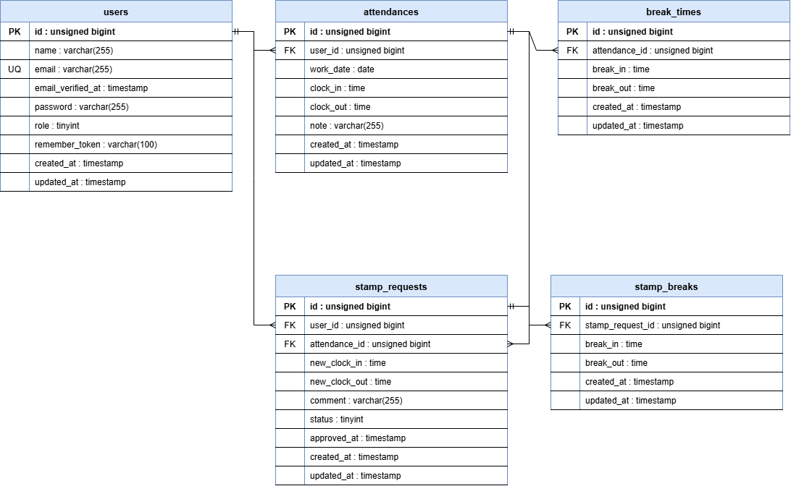

# 勤怠管理アプリ

一般ユーザーの勤怠打刻・勤怠確認・修正申請と、管理者による勤怠管理・修正申請承認を行うアプリケーションです。

## 環境構築

Docker が必要です。Windows の場合は WSL2 上で実行してください。

### Dockerビルド

1. リポジトリを取得（基本版は `basic` ブランチ）

    ```bash
    git clone -b basic https://github.com/phatnguyen-1998/attendance-app.git
    cd attendance-app
    ```

2. 依存パッケージのインストール（Sail 起動前のため Docker 経由で実行）

    ```bash
    docker run --rm \
        -u "$(id -u):$(id -g)" \
        -v "$(pwd):/var/www/html" \
        -w /var/www/html \
        -e COMPOSER_CACHE_DIR=/tmp/composer_cache \
        laravelsail/php82-composer:latest \
        composer install --ignore-platform-reqs
    ```

3. `.env` を作成（DB・メールの設定は `.env.example` のまま使えます）

    ```bash
    cp .env.example .env
    ```

4. コンテナを起動

    ```bash
    ./vendor/bin/sail up -d
    ```

※ Apple Silicon の場合は、`compose.yaml` の `mysql` サービスに `platform: 'linux/amd64'` を追加してください。

### Laravel環境構築

MySQL の起動完了を待ってから実行してください。

```bash
./vendor/bin/sail artisan key:generate
./vendor/bin/sail artisan migrate --seed
./vendor/bin/sail npm install
./vendor/bin/sail npm run build   # 開発時は npm run dev
```

## ログイン情報

| 種別 | 名前 | メールアドレス | パスワード | ログイン画面 |
| --- | --- | --- | --- | --- |
| 管理者 | ユーザー３（管理者） | user3@example.com | password | http://localhost/admin/login |
| 一般ユーザー | ユーザー１（一般） | user1@example.com | password | http://localhost/login |
| 一般ユーザー | ユーザー２（一般） | user2@example.com | password | http://localhost/login |

一般ユーザーには、直近60日間の平日分の勤怠・休憩ダミーデータ（今日の分を除く）が登録されます。

## 使用技術（実行環境）

- PHP 8.2
- Laravel 10.x
- Laravel Fortify（認証）
- MySQL 8.4
- Vite
- Docker（Laravel Sail）/ phpMyAdmin / Mailpit
- PHPUnit / Laravel Pint

## ER図



## URL

- 開発環境：http://localhost/login
- phpMyAdmin：http://localhost:8080/
- Mailpit：http://localhost:8025/

## 画面一覧

| 画面ID | 画面名称 | パス |
| --- | --- | --- |
| PG01 | 会員登録画面（一般ユーザー） | /register |
| PG02 | ログイン画面（一般ユーザー） | /login |
| PG03 | 勤怠登録画面（一般ユーザー） | /attendance |
| PG04 | 勤怠一覧画面（一般ユーザー） | /attendance/list |
| PG05 | 勤怠詳細画面（一般ユーザー） | /attendance/{id} |
| PG06 | 申請一覧画面（一般ユーザー） | /stamp_correction_request/list |
| PG07 | ログイン画面（管理者） | /admin/login |
| PG08 | 勤怠一覧画面（管理者） | /admin/attendance/list |
| PG09 | 勤怠詳細画面（管理者） | /attendance/{id}（一般ユーザーと同じパス。認証ミドルウェアで区別） |
| PG10 | スタッフ一覧画面（管理者） | /admin/staff/list |
| PG11 | スタッフ別勤怠一覧画面（管理者） | /admin/attendance/staff/{id} |
| PG12 | 申請一覧画面（管理者） | /stamp_correction_request/list（一般ユーザーと同じパス。認証ミドルウェアで区別） |
| PG13 | 修正申請承認画面（管理者） | /stamp_correction_request/approve/{attendance_correct_request_id} |

## テストの実行方法

```bash
./vendor/bin/sail artisan test
```

テストは `testing` データベースを使用します（Sail の MySQL コンテナ初回起動時に作成されます）。
