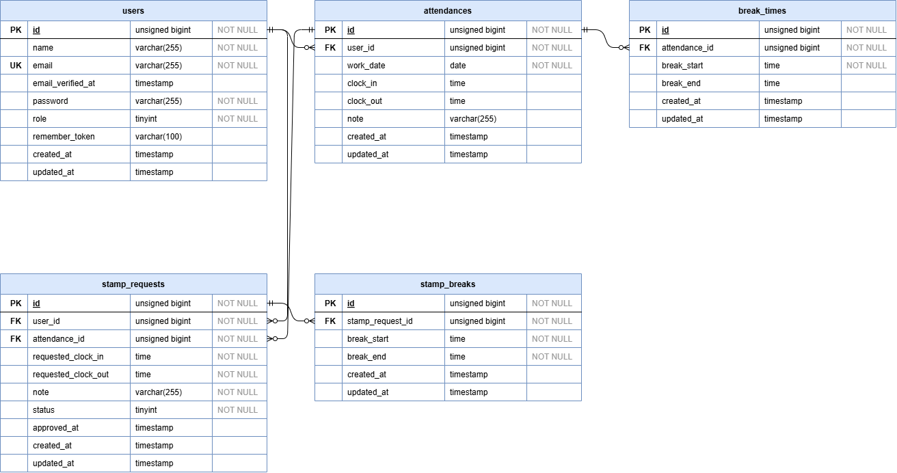

# 勤怠管理アプリ

一般ユーザーの勤怠打刻・勤怠確認・修正申請と、管理者による勤怠管理・修正申請承認を行うアプリケーションです。

## 環境構築

### Dockerビルド

1. `git clone <リポジトリURL>`
2. `cd attendance-app`
3. 依存パッケージのインストール（Sail 起動前のため Docker 経由で実行）

    ```bash
    docker run --rm \
        -u "$(id -u):$(id -g)" \
        -v "$(pwd):/var/www/html" \
        -w /var/www/html \
        laravelsail/php84-composer:latest \
        composer install --ignore-platform-reqs
    ```

4. `cp .env.example .env`（DB・メールの環境変数を設定）
5. `./vendor/bin/sail up -d`

### Laravel環境構築

1. `./vendor/bin/sail artisan key:generate`
2. `./vendor/bin/sail artisan migrate --seed`
3. `./vendor/bin/sail npm install`
4. `./vendor/bin/sail npm run build`（開発時は `npm run dev`）

## 使用技術（実行環境）

- PHP 8.x
- Laravel 10.x
- Laravel Fortify（認証）
- MySQL 8.4
- Vite
- Docker（Laravel Sail）/ phpMyAdmin / Mailpit

## ER図



## テストアカウント

`php artisan migrate --seed` 実行後、以下のアカウントでログインできます。

| 種別 | 名前 | メールアドレス | パスワード |
| --- | --- | --- | --- |
| 管理者 | admin | admin123@gmail.com | 12345678 |
| 一般ユーザー | user | user123@gmail.com | 12345678 |

## 画面一覧

| 画面ID | 画面名称 | パス |
| --- | --- | --- |
| PG01 | 会員登録画面（一般ユーザー） | /register |
| PG02 | ログイン画面（一般ユーザー） | /login |
| PG03 | 勤怠登録画面（一般ユーザー） | /attendance |
| PG04 | 勤怠一覧画面（一般ユーザー） | /attendance/list |
| PG05 | 勤怠詳細画面（一般ユーザー） | /attendance/detail/{id} |
| PG06 | 申請一覧画面（一般ユーザー） | /stamp_correction_request/list |
| PG07 | ログイン画面（管理者） | /admin/login |
| PG08 | 勤怠一覧画面（管理者） | /admin/attendance/list |
| PG09 | 勤怠詳細画面（管理者） | /admin/attendance/{id} |
| PG10 | スタッフ一覧画面（管理者） | /admin/staff/list |
| PG11 | スタッフ別勤怠一覧画面（管理者） | /admin/attendance/staff/{id} |
| PG12 | 申請一覧画面（管理者） | /stamp_correction_request/list（一般ユーザーと同じパス。認証ミドルウェアで区別） |
| PG13 | 修正申請承認画面（管理者） | /stamp_correction_request/approve/{attendance_correct_request_id} |
| ★ PG14 | マイ勤怠レポート画面（一般ユーザー） | /attendance/report |

## URL

- 開発環境：http://localhost/
- phpMyAdmin：http://localhost:8080/
- Mailpit：http://localhost:8025/
